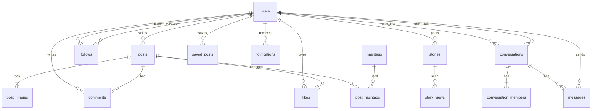

# 데이터베이스 설계 명세서 (SQLite)

저장소는 단일 SQLite 파일 `instagram.db`이다. ORM은 SQLAlchemy 2.x이며, 아래 DDL이 소스 오브 트루스다.

## 1. 원칙

- PK: `INTEGER PRIMARY KEY AUTOINCREMENT`
- 시각: UTC ISO, 컬럼 타입 `TEXT`에 ISO 8601 (`YYYY-MM-DDTHH:MM:SSZ`)
- 논리 삭제 없음. 게시물/댓글/스토리는 물리 삭제
- 비밀번호는 bcrypt 해시만 저장
- FK는 `ON DELETE CASCADE`를 기본으로 하여 고아 행을 남기지 않는다
- SQLite에서 `PRAGMA foreign_keys = ON` 필수 (`database.py` 연결 이벤트)

## 2. ER 개요



`users.is_admin=1`인 행은 관리자다. 별도 admin 테이블 없이 플래그로만 구분한다(§3.1).

## 3. 테이블

### 3.1 `users`

| 컬럼 | 타입 | 제약 | 설명 |
|------|------|------|------|
| id | INTEGER | PK | |
| email | TEXT | NOT NULL, UNIQUE | 소문자 저장 |
| username | TEXT | NOT NULL, UNIQUE | 소문자, 1~30 |
| full_name | TEXT | NOT NULL DEFAULT `''` | |
| password_hash | TEXT | NOT NULL | |
| bio | TEXT | DEFAULT `''` | 최대 150은 앱 계층 |
| website | TEXT | DEFAULT `''` | |
| avatar_url | TEXT | NULL | `/media/avatars/...` |
| is_private | INTEGER | NOT NULL DEFAULT 0, CHECK 0/1 | 비공개 계정 |
| show_activity_status | INTEGER | NOT NULL DEFAULT 1, CHECK 0/1 | 활동 상태 표시 여부 |
| is_admin | INTEGER | NOT NULL DEFAULT 0, CHECK 0/1 | 관리자 플래그, 별도 테이블 없음 |
| created_at | TEXT | NOT NULL | |
| updated_at | TEXT | NOT NULL | |

CHECK: `username = lower(username)`, `email = lower(email)` (대소문자 섞어 저장 금지).

인덱스: UNIQUE(email), UNIQUE(username) + `COLLATE NOCASE` UNIQUE 인덱스 `uq_users_username_nocase`, `uq_users_email_nocase`(대소문자 다른 중복 방지). 검색용 `username`, `full_name`.

### 3.2 `posts`

| 컬럼 | 타입 | 제약 | 설명 |
|------|------|------|------|
| id | INTEGER | PK | |
| user_id | INTEGER | NOT NULL, FK users.id CASCADE | |
| caption | TEXT | DEFAULT `''` | |
| location | TEXT | DEFAULT `''` | |
| created_at | TEXT | NOT NULL | |
| updated_at | TEXT | NOT NULL | |

인덱스: `(user_id, created_at DESC)`, `(created_at DESC)` 피드/탐색.

### 3.3 `post_images`

| 컬럼 | 타입 | 제약 | 설명 |
|------|------|------|------|
| id | INTEGER | PK | |
| post_id | INTEGER | NOT NULL, FK posts.id CASCADE | |
| url | TEXT | NOT NULL | |
| position | INTEGER | NOT NULL DEFAULT 0 | 0부터 |

UNIQUE `(post_id, position)`.

### 3.4 `comments`

| 컬럼 | 타입 | 제약 | 설명 |
|------|------|------|------|
| id | INTEGER | PK | |
| post_id | INTEGER | NOT NULL, FK posts.id CASCADE | |
| user_id | INTEGER | NOT NULL, FK users.id CASCADE | |
| body | TEXT | NOT NULL | |
| created_at | TEXT | NOT NULL | |

인덱스: `(post_id, created_at)`.

### 3.5 `likes`

게시물 좋아요. 댓글 좋아요는 1차 범위 밖.

| 컬럼 | 타입 | 제약 | 설명 |
|------|------|------|------|
| id | INTEGER | PK | |
| post_id | INTEGER | NOT NULL, FK posts.id CASCADE | |
| user_id | INTEGER | NOT NULL, FK users.id CASCADE | |
| created_at | TEXT | NOT NULL | |

UNIQUE `(post_id, user_id)`.

### 3.6 `saved_posts`

| 컬럼 | 타입 | 제약 | 설명 |
|------|------|------|------|
| id | INTEGER | PK | |
| post_id | INTEGER | NOT NULL, FK posts.id CASCADE | |
| user_id | INTEGER | NOT NULL, FK users.id CASCADE | |
| created_at | TEXT | NOT NULL | |

UNIQUE `(post_id, user_id)`.

### 3.7 `follows`

`follower_id`가 `following_id`를 팔로우한다.

| 컬럼 | 타입 | 제약 | 설명 |
|------|------|------|------|
| id | INTEGER | PK | |
| follower_id | INTEGER | NOT NULL, FK users.id CASCADE | 나 |
| following_id | INTEGER | NOT NULL, FK users.id CASCADE | 상대 |
| created_at | TEXT | NOT NULL | |

UNIQUE `(follower_id, following_id)`.  
CHECK `follower_id != following_id`.

인덱스: `(following_id)` 팔로워 목록, `(follower_id)` 팔로잉 목록·피드 조인.

### 3.8 `hashtags`

| 컬럼 | 타입 | 제약 | 설명 |
|------|------|------|------|
| id | INTEGER | PK | |
| name | TEXT | NOT NULL UNIQUE | 소문자, `#` 제외 |
| created_at | TEXT | NOT NULL | |

UNIQUE(name) + `COLLATE NOCASE` UNIQUE 인덱스 `uq_hashtags_name_nocase`.

### 3.9 `post_hashtags`

| 컬럼 | 타입 | 제약 | 설명 |
|------|------|------|------|
| post_id | INTEGER | NOT NULL, FK posts.id CASCADE | |
| hashtag_id | INTEGER | NOT NULL, FK hashtags.id CASCADE | |

PK `(post_id, hashtag_id)`.

### 3.10 `stories`

| 컬럼 | 타입 | 제약 | 설명 |
|------|------|------|------|
| id | INTEGER | PK | |
| user_id | INTEGER | NOT NULL, FK users.id CASCADE | |
| media_url | TEXT | NOT NULL | |
| created_at | TEXT | NOT NULL | |

만료는 컬럼 없이 `created_at + 24시간`으로 계산한다.  
인덱스: `(user_id, created_at DESC)`.

### 3.11 `story_views`

| 컬럼 | 타입 | 제약 | 설명 |
|------|------|------|------|
| story_id | INTEGER | NOT NULL, FK stories.id CASCADE | |
| user_id | INTEGER | NOT NULL, FK users.id CASCADE | |
| created_at | TEXT | NOT NULL | |

PK `(story_id, user_id)`.

### 3.12 `conversations`

1:1만 지원. 참가자 두 명을 테이블 자체 컬럼(`user_low_id` < `user_high_id`)으로 고정해 **DB 레벨에서** 쌍 유니크를 보장한다. `conversation_members`는 참가자별 메타데이터(읽음 위치)용 보조 테이블이다.

| 컬럼 | 타입 | 제약 | 설명 |
|------|------|------|------|
| id | INTEGER | PK | |
| user_low_id | INTEGER | NOT NULL, FK users.id CASCADE | 두 참가자 중 id가 작은 쪽 |
| user_high_id | INTEGER | NOT NULL, FK users.id CASCADE | 두 참가자 중 id가 큰 쪽 |
| created_at | TEXT | NOT NULL | |
| updated_at | TEXT | NOT NULL | 마지막 메시지 시각 |

UNIQUE `(user_low_id, user_high_id)`.  
CHECK `user_low_id < user_high_id`.

생성 시 두 유저 id를 정렬해 `user_low_id`/`user_high_id`에 넣고, 이미 있으면 기존 행을 재사용한다(앱 계층, `POST /conversations`).

### 3.13 `conversation_members`

| 컬럼 | 타입 | 제약 | 설명 |
|------|------|------|------|
| conversation_id | INTEGER | NOT NULL, FK conversations.id CASCADE | |
| user_id | INTEGER | NOT NULL, FK users.id CASCADE | |
| last_read_message_id | INTEGER | NULL, **FK messages.id ON DELETE SET NULL** | 그 메시지가 지워지면 NULL |
| created_at | TEXT | NOT NULL | |

PK `(conversation_id, user_id)`. 인덱스: `(user_id)`.

한 대화에는 정확히 `conversations.user_low_id`, `user_high_id` 두 명만 멤버가 될 수 있다 — 이 불변식은 트리거(§3.16)로 DB 레벨에서 강제한다.

### 3.14 `messages`

| 컬럼 | 타입 | 제약 | 설명 |
|------|------|------|------|
| id | INTEGER | PK | |
| conversation_id | INTEGER | NOT NULL, FK conversations.id CASCADE | |
| sender_id | INTEGER | NOT NULL, FK users.id CASCADE | |
| body | TEXT | NOT NULL | |
| created_at | TEXT | NOT NULL | |

인덱스: `(conversation_id, id)`.  
이미지 메시지는 1차 범위 밖(텍스트만).

### 3.15 `notifications`

| 컬럼 | 타입 | 제약 | 설명 |
|------|------|------|------|
| id | INTEGER | PK | |
| user_id | INTEGER | NOT NULL, FK users.id CASCADE | 수신자 |
| actor_id | INTEGER | NOT NULL, FK users.id CASCADE | 행위자 |
| type | TEXT | NOT NULL | `follow` `like` `comment` `mention` |
| post_id | INTEGER | NULL, FK posts.id CASCADE | |
| comment_id | INTEGER | NULL, FK comments.id CASCADE | |
| comment_preview | TEXT | NULL | 최대 80자 스냅샷 |
| read | INTEGER | NOT NULL DEFAULT 0 | 0/1 |
| created_at | TEXT | NOT NULL | |

인덱스: `(user_id, created_at DESC)`, `(user_id, read)`.

### 3.16 트리거 (DM 불변식)

SQLite 트리거로 `conversation_members`/`messages`에 ORM만으로는 못 내리는 제약을 강제한다. `database.py`가 기동 시 기존 트리거를 지우고 재생성한다.

| 트리거 | 대상 | 막는 것 |
|--------|------|---------|
| `trg_members_pair_ins` | `conversation_members` BEFORE INSERT | `user_id`가 그 대화의 `user_low_id`/`user_high_id`가 아니거나, 멤버가 이미 2명이면 거부 |
| `trg_members_read_ins` | `conversation_members` BEFORE INSERT | `last_read_message_id`가 **같은 대화**의 메시지가 아니면 거부 |
| `trg_members_read_upd` | `conversation_members` BEFORE UPDATE OF last_read_message_id | 위와 동일(갱신 시) |
| `trg_messages_sender_ins` | `messages` BEFORE INSERT | `sender_id`가 그 대화의 멤버가 아니면 거부 |
| `trg_messages_sender_upd` | `messages` BEFORE UPDATE OF sender_id | 위와 동일(갱신 시) |

### 3.17 `schema_migrations`

| 컬럼 | 타입 | 제약 | 설명 |
|------|------|------|------|
| version | TEXT | PK | 마이그레이션 식별자 |
| applied_at | TEXT | NOT NULL | 적용 시각 |

`run_migrations()`가 컬럼 추가·인덱스·트리거 생성을 이 테이블에 기록해 재실행 시 멱등하게 건너뛴다.

## 4. DDL

```sql
PRAGMA foreign_keys = ON;

CREATE TABLE users (
  id INTEGER PRIMARY KEY AUTOINCREMENT,
  email TEXT NOT NULL UNIQUE,
  username TEXT NOT NULL UNIQUE,
  full_name TEXT NOT NULL DEFAULT '',
  password_hash TEXT NOT NULL,
  bio TEXT NOT NULL DEFAULT '',
  website TEXT NOT NULL DEFAULT '',
  avatar_url TEXT,
  is_private INTEGER NOT NULL DEFAULT 0,
  show_activity_status INTEGER NOT NULL DEFAULT 1,
  is_admin INTEGER NOT NULL DEFAULT 0,
  created_at TEXT NOT NULL,
  updated_at TEXT NOT NULL,
  CHECK (is_private IN (0, 1)),
  CHECK (show_activity_status IN (0, 1)),
  CHECK (is_admin IN (0, 1)),
  CHECK (username = lower(username)),
  CHECK (email = lower(email))
);
CREATE UNIQUE INDEX uq_users_username_nocase ON users(username COLLATE NOCASE);
CREATE UNIQUE INDEX uq_users_email_nocase ON users(email COLLATE NOCASE);
CREATE INDEX idx_users_full_name ON users(full_name);

CREATE TABLE posts (
  id INTEGER PRIMARY KEY AUTOINCREMENT,
  user_id INTEGER NOT NULL REFERENCES users(id) ON DELETE CASCADE,
  caption TEXT NOT NULL DEFAULT '',
  location TEXT NOT NULL DEFAULT '',
  created_at TEXT NOT NULL,
  updated_at TEXT NOT NULL
);
CREATE INDEX idx_posts_user_created ON posts(user_id, created_at DESC);
CREATE INDEX idx_posts_created ON posts(created_at DESC);

CREATE TABLE post_images (
  id INTEGER PRIMARY KEY AUTOINCREMENT,
  post_id INTEGER NOT NULL REFERENCES posts(id) ON DELETE CASCADE,
  url TEXT NOT NULL,
  position INTEGER NOT NULL DEFAULT 0,
  UNIQUE(post_id, position)
);

CREATE TABLE comments (
  id INTEGER PRIMARY KEY AUTOINCREMENT,
  post_id INTEGER NOT NULL REFERENCES posts(id) ON DELETE CASCADE,
  user_id INTEGER NOT NULL REFERENCES users(id) ON DELETE CASCADE,
  body TEXT NOT NULL,
  created_at TEXT NOT NULL
);
CREATE INDEX idx_comments_post ON comments(post_id, created_at);

CREATE TABLE likes (
  id INTEGER PRIMARY KEY AUTOINCREMENT,
  post_id INTEGER NOT NULL REFERENCES posts(id) ON DELETE CASCADE,
  user_id INTEGER NOT NULL REFERENCES users(id) ON DELETE CASCADE,
  created_at TEXT NOT NULL,
  UNIQUE(post_id, user_id)
);

CREATE TABLE saved_posts (
  id INTEGER PRIMARY KEY AUTOINCREMENT,
  post_id INTEGER NOT NULL REFERENCES posts(id) ON DELETE CASCADE,
  user_id INTEGER NOT NULL REFERENCES users(id) ON DELETE CASCADE,
  created_at TEXT NOT NULL,
  UNIQUE(post_id, user_id)
);
CREATE INDEX idx_saved_posts_user ON saved_posts(user_id, created_at DESC);

CREATE TABLE follows (
  id INTEGER PRIMARY KEY AUTOINCREMENT,
  follower_id INTEGER NOT NULL REFERENCES users(id) ON DELETE CASCADE,
  following_id INTEGER NOT NULL REFERENCES users(id) ON DELETE CASCADE,
  created_at TEXT NOT NULL,
  UNIQUE(follower_id, following_id),
  CHECK(follower_id != following_id)
);
CREATE INDEX idx_follows_following ON follows(following_id);
CREATE INDEX idx_follows_follower ON follows(follower_id);

CREATE TABLE hashtags (
  id INTEGER PRIMARY KEY AUTOINCREMENT,
  name TEXT NOT NULL UNIQUE,
  created_at TEXT NOT NULL
);
CREATE UNIQUE INDEX uq_hashtags_name_nocase ON hashtags(name COLLATE NOCASE);

CREATE TABLE post_hashtags (
  post_id INTEGER NOT NULL REFERENCES posts(id) ON DELETE CASCADE,
  hashtag_id INTEGER NOT NULL REFERENCES hashtags(id) ON DELETE CASCADE,
  PRIMARY KEY(post_id, hashtag_id)
);
CREATE INDEX idx_post_hashtags_hashtag ON post_hashtags(hashtag_id);

CREATE TABLE stories (
  id INTEGER PRIMARY KEY AUTOINCREMENT,
  user_id INTEGER NOT NULL REFERENCES users(id) ON DELETE CASCADE,
  media_url TEXT NOT NULL,
  created_at TEXT NOT NULL
);
CREATE INDEX idx_stories_user ON stories(user_id, created_at DESC);

CREATE TABLE story_views (
  story_id INTEGER NOT NULL REFERENCES stories(id) ON DELETE CASCADE,
  user_id INTEGER NOT NULL REFERENCES users(id) ON DELETE CASCADE,
  created_at TEXT NOT NULL,
  PRIMARY KEY(story_id, user_id)
);

-- messages를 참조하는 last_read_message_id가 있으므로, messages를 먼저 만든다.
CREATE TABLE conversations (
  id INTEGER PRIMARY KEY AUTOINCREMENT,
  user_low_id INTEGER NOT NULL REFERENCES users(id) ON DELETE CASCADE,
  user_high_id INTEGER NOT NULL REFERENCES users(id) ON DELETE CASCADE,
  created_at TEXT NOT NULL,
  updated_at TEXT NOT NULL,
  UNIQUE(user_low_id, user_high_id),
  CHECK(user_low_id < user_high_id)
);

CREATE TABLE messages (
  id INTEGER PRIMARY KEY AUTOINCREMENT,
  conversation_id INTEGER NOT NULL REFERENCES conversations(id) ON DELETE CASCADE,
  sender_id INTEGER NOT NULL REFERENCES users(id) ON DELETE CASCADE,
  body TEXT NOT NULL,
  created_at TEXT NOT NULL
);
CREATE INDEX idx_messages_conv ON messages(conversation_id, id);

CREATE TABLE conversation_members (
  conversation_id INTEGER NOT NULL REFERENCES conversations(id) ON DELETE CASCADE,
  user_id INTEGER NOT NULL REFERENCES users(id) ON DELETE CASCADE,
  last_read_message_id INTEGER REFERENCES messages(id) ON DELETE SET NULL,
  created_at TEXT NOT NULL,
  PRIMARY KEY(conversation_id, user_id)
);
CREATE INDEX idx_conversation_members_user ON conversation_members(user_id);

-- DM 불변식(§3.16): 멤버는 그 대화의 user_low_id/user_high_id 두 명뿐,
-- last_read_message_id/sender_id는 같은 대화의 멤버/메시지만 가리킨다.
CREATE TRIGGER trg_members_pair_ins
BEFORE INSERT ON conversation_members
FOR EACH ROW
WHEN NEW.user_id NOT IN (
    SELECT user_low_id FROM conversations WHERE id = NEW.conversation_id
    UNION
    SELECT user_high_id FROM conversations WHERE id = NEW.conversation_id
)
OR (
    SELECT COUNT(*) FROM conversation_members WHERE conversation_id = NEW.conversation_id
) >= 2
BEGIN
  SELECT RAISE(ABORT, 'conversation members must be the unique pair');
END;

CREATE TRIGGER trg_members_read_ins
BEFORE INSERT ON conversation_members
FOR EACH ROW
WHEN NEW.last_read_message_id IS NOT NULL
 AND NOT EXISTS (
    SELECT 1 FROM messages
    WHERE id = NEW.last_read_message_id AND conversation_id = NEW.conversation_id
 )
BEGIN
  SELECT RAISE(ABORT, 'last_read_message_id must reference a message in the same conversation');
END;

CREATE TRIGGER trg_members_read_upd
BEFORE UPDATE OF last_read_message_id ON conversation_members
FOR EACH ROW
WHEN NEW.last_read_message_id IS NOT NULL
 AND NOT EXISTS (
    SELECT 1 FROM messages
    WHERE id = NEW.last_read_message_id AND conversation_id = NEW.conversation_id
 )
BEGIN
  SELECT RAISE(ABORT, 'last_read_message_id must reference a message in the same conversation');
END;

CREATE TRIGGER trg_messages_sender_ins
BEFORE INSERT ON messages
FOR EACH ROW
WHEN NOT EXISTS (
    SELECT 1 FROM conversation_members
    WHERE conversation_id = NEW.conversation_id AND user_id = NEW.sender_id
)
BEGIN
  SELECT RAISE(ABORT, 'sender must be a conversation member');
END;

CREATE TRIGGER trg_messages_sender_upd
BEFORE UPDATE OF sender_id ON messages
FOR EACH ROW
WHEN NOT EXISTS (
    SELECT 1 FROM conversation_members
    WHERE conversation_id = NEW.conversation_id AND user_id = NEW.sender_id
)
BEGIN
  SELECT RAISE(ABORT, 'sender must be a conversation member');
END;

CREATE TABLE notifications (
  id INTEGER PRIMARY KEY AUTOINCREMENT,
  user_id INTEGER NOT NULL REFERENCES users(id) ON DELETE CASCADE,
  actor_id INTEGER NOT NULL REFERENCES users(id) ON DELETE CASCADE,
  type TEXT NOT NULL,
  post_id INTEGER REFERENCES posts(id) ON DELETE CASCADE,
  comment_id INTEGER REFERENCES comments(id) ON DELETE CASCADE,
  comment_preview TEXT,
  read INTEGER NOT NULL DEFAULT 0,
  created_at TEXT NOT NULL
);
CREATE INDEX idx_notifications_user ON notifications(user_id, created_at DESC);
CREATE INDEX idx_notifications_user_read ON notifications(user_id, read);

CREATE TABLE schema_migrations (
  version TEXT PRIMARY KEY,
  applied_at TEXT NOT NULL
);
```

## 5. 주요 쿼리

### 5.1 홈 피드

```sql
SELECT p.*
FROM posts p
WHERE p.user_id = :me
   OR p.user_id IN (SELECT following_id FROM follows WHERE follower_id = :me)
ORDER BY p.created_at DESC, p.id DESC
LIMIT :limit;
```

커서는 `(created_at, id)` 튜플을 base64 JSON으로 인코딩한다.

### 5.2 스토리 피드 (유효)

```sql
SELECT * FROM stories
WHERE created_at >= :cutoff_iso  -- now - 24h
  AND (user_id = :me OR user_id IN (
        SELECT following_id FROM follows WHERE follower_id = :me
      ))
ORDER BY created_at DESC;
```

애플리케이션에서 `user_id`로 그룹핑한다.

### 5.3 미읽음 DM

```sql
SELECT COUNT(*) FROM messages m
WHERE m.conversation_id = :cid
  AND m.sender_id != :me
  AND m.id > COALESCE(:last_read_message_id, 0);
```

### 5.4 해시태그 게시물 수

```sql
SELECT h.name, COUNT(ph.post_id) AS posts_count
FROM hashtags h
LEFT JOIN post_hashtags ph ON ph.hashtag_id = h.id
WHERE h.name LIKE :q || '%'
GROUP BY h.id;
```

## 6. 시드 데이터

| username | email | 관계 |
|----------|-------|------|
| demo | demo@local.test | alice, bob 팔로우 |
| alice | alice@local.test | demo 팔로우 |
| bob | bob@local.test | - |
| cara, dan | cara/dan@local.test | 탐색용, demo가 안 팔로우 |
| admin | admin@local.test | `is_admin=1`, 팔로우 관계 없음 |

게시물·이미지는 `backend.md` 시드와 동일. 해시태그 예: `korea`, `food`, `sunset`. `admin` 계정은 `ensure_admin_user()`가 기동 시마다 멱등하게 보장한다(§3.17 관련 로직은 `database.py`, 계정 생성은 `seed.py`).

## 7. 백업·운영

- 파일 복사: `instagram.db` (+ WAL 사용 시 `-wal`, `-shm`)
- 업로드 파일은 DB와 별도. 백업 시 `uploads/` 포함
- 동시 쓰기는 SQLite 특성상 제한적. 학습·데모 규모(동시 접속 소수)를 전제로 한다
