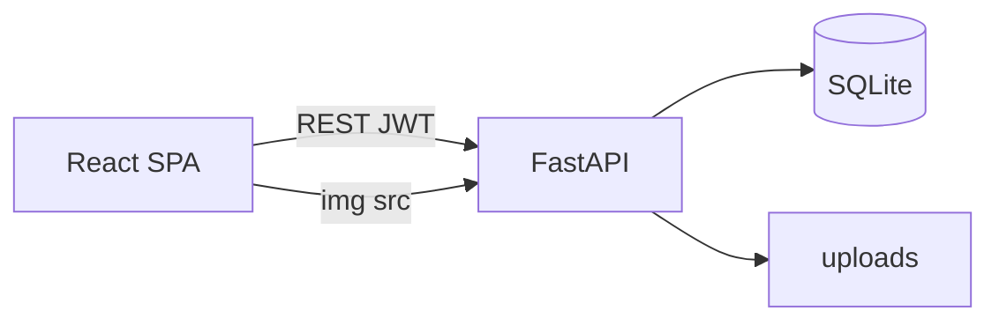

# 전체 프로젝트 가이드

Instagram 클론(React + FastAPI + SQLite)의 저장소 지도, 실행 방법, 구현 순서, 문서 간 계약이다.

관련 문서:

| 파일 | 내용 |
|------|------|
| `front.md` | 화면, 라우트, 컴포넌트, UX |
| `backend.md` | REST API, 인증, 업로드 |
| `db.md` | SQLite 스키마, DDL, 쿼리 |

세 문서는 **같은 기능 범위**를 가리킨다. 충돌 시 우선순위: `db.md`(데이터) → `backend.md`(계약) → `front.md`(표현).

## 1. 무엇을 만드는가

웹 브라우저용 Instagram 유사 SNS.

포함: 가입/로그인, 이미지 게시(1~10장), 피드, 탐색, 검색, 좋아요, 댓글, 저장, 팔로우, 프로필, 24시간 스토리, 텍스트 DM, 알림.

제외(1차): 릴스, 라이브, 쇼핑, 광고, 위치 지도, 영상 업로드, 그룹 DM, 읽음 영수증 UI 고도화, 실시간 웹소켓.

## 2. 아키텍처

```text
브라우저 (Vite :5173)
    │  /api, /media → Vite 프록시 → FastAPI
    │  JSON / multipart + Bearer JWT (ig_token)
    ▼
FastAPI (:8000)  /api/*
    │
    ├─ SQLite  instagram.db
    └─ 디스크  uploads/  →  /media 정적 서빙
```

SPA는 세션 쿠키를 쓰지 않는다. 토큰은 프론트 `localStorage`.



## 3. 저장소 구조 (구현 시)

```text
my_instagram/
  package.json              # npm run dev
  scripts/dev.js
  start.bat
  start.ps1
  front.md
  backend.md
  db.md
  guide.md
  frontend/
    package.json
    vite.config.js
    index.html
    src/
  backend/
    requirements.txt
    app/
    uploads/
    instagram.db          # gitignore
  .gitignore
  README.md               # 이 가이드의 실행 절을 요약해도 됨
```

`.gitignore` 최소:

```
node_modules/
dist/
__pycache__/
.venv/
instagram.db
instagram.db-*
uploads/
.env
```

시드용 샘플 이미지는 `backend/seed_assets/`처럼 코드와 함께 두어도 된다.

## 4. 환경

- Node.js 18+
- Python 3.11+
- 운영체제: Windows (`npm run dev` 기준)

### 4.1 실행 (권장)

프로젝트 루트(또는 `frontend/`)에서:

```powershell
npm run dev
```

이 명령이 패키지 설치, `.env` 준비, FastAPI·Vite 기동, 브라우저 열기까지 처리한다. 종료는 `Ctrl+C`.

| 항목 | 주소 |
|------|------|
| 앱 | http://localhost:5173 |
| API 문서 | http://localhost:8000/docs |
| 데모 계정 | `demo` / `demo1234` |

### 4.2 수동 실행 (원클릭을 쓰지 않을 때)

백엔드:

```powershell
cd backend
python -m venv .venv
.\.venv\Scripts\Activate.ps1
pip install -r requirements.txt
copy .env.example .env
uvicorn app.main:app --reload --port 8000
```

프론트엔드:

```powershell
cd frontend
npm install
copy .env.example .env
npm run dev
```

`.env` 예:

```
`frontend/.env` (개발 기본 — Vite 프록시와 함께 사용):

```env
VITE_API_BASE_URL=/api
VITE_API_ORIGIN=
```

프록시 없이 직접 호출할 때만 `http://localhost:8000` 절대 URL을 쓴다.
```

## 5. 구현 순서 (권장)

의존이 적은 층부터 올린다. 한 단계가 동작한 뒤에 다음으로 간다.

1. **골격**  
   FastAPI Hello + CORS + SQLite `users` + signup/login + React 로그인 화면.

2. **게시물**  
   업로드, 상세, 본인 프로필 그리드.

3. **소셜**  
   좋아요, 댓글, 팔로우, 홈 피드.

4. **탐색·검색·해시태그·저장**

5. **스토리**

6. **DM + 알림**

7. **반응형 다듬기, 시드, 빈 상태, 에러 토스트**

각 단계 종료 시 `front.md` §10 / `backend.md` §17 체크리스트를 갱신한다.

## 6. API·화면 매핑

| 화면 | 주요 API |
|------|----------|
| 로그인 | `POST /auth/login` |
| 가입 | `POST /auth/signup` |
| 홈 | `GET /stories/feed`, `GET /posts/feed`, `GET /users/suggested` |
| 탐색 | `GET /posts/explore` |
| 검색 | `GET /search` |
| 작성 | `POST /posts` |
| 상세 | `GET /posts/{id}`, comments, like, save |
| 프로필 | `GET /users/{username}`, posts, follow |
| DM | conversations, messages |
| 알림 | `GET /notifications` |

필드 이름·상태 코드는 `backend.md`를 변경하지 말고 프론트가 맞춘다.

## 7. 인증 흐름

1. 가입/로그인 → `{ access_token, user }`
2. 프론트 `ig_token` 저장, Axios 헤더
3. 새로고침 → `GET /auth/me`로 `user` 복구
4. 401 → 토큰 삭제, `/login`

비밀번호는 로그에 남기지 않는다. `SECRET_KEY`는 `.env`만 사용.

## 8. 미디어

- 업로드 최대 10MB/장, jpeg/png/webp
- DB `avatar_url` / `url` / `media_url`은 `/media/...` 상대 경로
- 프론트 표시: `VITE_API_ORIGIN`이 있으면 `${origin}${url}`, 없으면 `/media/...` 상대 경로 (프록시)
- 게시물 삭제 시 파일 삭제 시도

## 9. 시간·페이지네이션

- 서버는 UTC ISO 문자열
- 프론트만 상대 시간
- 커서는 opaque. 프론트는 값을 해석하지 않고 다음 요청에 그대로 붙인다

## 10. 개발 규약

- 커밋 메시지는 왜(why)를 한두 문장으로 (예: 피드가 팔로잉만 보이게)
- API 변경 시 `backend.md`와 프론트 `src/api/*`를 같은 작업에서 맞춘다
- 스키마 변경 시 `db.md` DDL과 SQLAlchemy 모델을 같이 수정. 기존 DB는 삭제 후 시드(개발 단계)
- 비밀키, `.db`, 사용자 업로드는 커밋하지 않음

## 11. 테스트 시나리오 (수동)

데모 계정으로 다음을 통과해야 “1차 완료”다.

1. `demo` 로그인 → 피드에 alice/bob 글이 보인다
2. 이미지 1장 게시 → 프로필 그리드·피드에 나타난다
3. 좋아요 토글, 댓글 작성, 저장 후 `/:username/saved`
4. bob 팔로우/언팔로우, 팔로워 수 변화
5. `#korea` 검색
6. 스토리 업로드 후 링 표시, 24시간 로직은 서버 `cutoff`로 단위 확인
7. alice에게 DM 왕복 (alice로 다른 브라우저/시크릿)
8. 좋아요 시 alice 알림
9. 토큰 삭제 후 보호 라우트 → 로그인
10. 375px 폭에서 하단 탭으로 홈/탐색/작성/알림/프로필 이동

## 12. 완료 정의

아래가 모두 참이면 프로젝트를 닫을 수 있다.

- `frontend`와 `backend`가 로컬에서 동시에 실행된다
- `front.md` 라우트가 모두 존재하고 치명적 깨짐이 없다
- `backend.md` 엔드포인트가 `/docs`와 실제 동작으로 확인된다
- `db.md` 테이블이 DB에 존재하고 FK가 켜져 있다
- 시드 계정으로 §11 시나리오가 통과한다

## 13. 이후 확장 (선택)

웹소켓 DM, 게시물 수정, 댓글 좋아요, 팔로우 요청(비공개 계정), 이미지 리사이즈, PostgreSQL 전환, JWT 리프레시 토큰.
