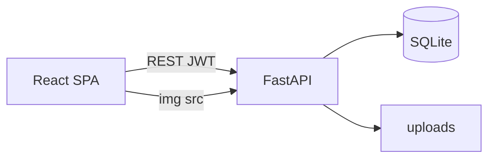

# 전체 프로젝트 가이드

Instagram 클론(React + FastAPI + SQLite)의 **저장소 지도**, **기술 개요**, **실행 방법**, **문서 간 계약**이다.

| 항목 | 내용 |
|------|------|
| GitHub | [jsw7890/instagram-clone](https://github.com/jsw7890/instagram-clone) |
| 로컬 경로 예 | `my_instagram/` (루트에서 `npm run dev`) |

관련 문서:

| 파일 | 내용 |
|------|------|
| `front.md` | 화면, 라우트, 컴포넌트, UX |
| `backend.md` | REST API, 인증, 업로드 |
| `db.md` | SQLite 스키마, DDL, 쿼리 |

세 문서는 **같은 기능 범위**를 가리킨다. 충돌 시 우선순위: `db.md`(데이터) → `backend.md`(계약) → `front.md`(표현).

---

## 1. 프로젝트 개요

웹 브라우저용 **Instagram 유사 SNS** 풀스택 클론이다. 프론트는 SPA, 백엔드는 REST + JWT, 데이터는 단일 SQLite 파일로 운영한다.

### 1.1 주요 기능 (사용자 앱)

| 영역 | 기능 |
|------|------|
| 계정 | 회원가입, 로그인, 로그아웃, 비밀번호 변경, 프로필·아바타 편집, 비공개 계정·활동 상태 |
| 게시물 | 이미지 1~10장 캐러셀, 캡션, 해시태그, 좋아요, 댓글, 저장, 삭제 |
| 소셜 | 팔로우/언팔로우, 홈 피드(팔로잉), 추천 계정, 팔로워/팔로잉 목록 |
| 탐색·검색 | 탐색 그리드, 통합 검색(계정·태그·게시물) |
| 스토리 | 24시간 스토리 업로드·피드·조회·삭제 |
| DM | 1:1 텍스트 대화, 대화 목록·스레드 |
| 알림 | 좋아요·댓글·팔로우 등 알림, 읽음 처리, 단건 삭제 |
| UX | 데스크톱 사이드바 + 모바일 하단 탭, `MobileHeader`, 토스트, 보호 라우트 |

**게스트 둘러보기:** 로그인 없이도 피드·탐색·검색·게시 상세·타인 프로필 **읽기**가 가능하다(쓰기는 로그인 필요).

### 1.2 관리자(Admin)

| 항목 | 내용 |
|------|------|
| 경로 | `/admin/login`, `/admin`, `/admin/users`, `/admin/posts` |
| API | `/api/admin/*` (관리자 JWT) |
| 시드 계정 | `admin` / `pass123` (`is_admin` 플래그) |
| 역할 | 사용자·게시물 목록 조회, 관리 작업(명세는 `backend.md` §관리자) |

### 1.3 범위 밖 (1차)

릴스, 라이브, 쇼핑, 광고, 위치 지도, **영상** 업로드, 그룹 DM, 웹소켓 실시간, 읽음 영수증 UI 고도화, PostgreSQL 필수화 등.

---

## 2. 기술적 특징

### 2.1 스택 요약

| 층 | 기술 | 비고 |
|----|------|------|
| 프론트 | React 18, Vite 6, React Router 6, Axios | JavaScript (JSX), TypeScript 미사용 |
| 백엔드 | FastAPI, Uvicorn, Pydantic v2, SQLAlchemy 2.x | Python 3.11+ |
| DB | SQLite (`instagram.db`) | `PRAGMA foreign_keys=ON`, 런타임 마이그레이션 |
| 인증 | JWT (HS256), Bearer | 클라이언트 `localStorage` 키 `ig_token` |
| 비밀번호 | passlib + bcrypt | 8~72자 |
| 미디어 | 로컬 `uploads/` | FastAPI `/media` 정적 서빙, jpeg/png/webp |
| 테스트 | pytest + httpx TestClient | `backend/tests/` (스모크·코어·데모·관리자) |

### 2.2 아키텍처

```text
브라우저 (Vite :5173)
    │  /api, /media → Vite 프록시 → FastAPI
    │  JSON / multipart + Bearer JWT (ig_token)
    ▼
FastAPI (:8000)  /api/*
    │
    ├─ SQLite  instagram.db  (+ schema_migrations)
    └─ 디스크  uploads/  →  /media 정적 서빙
```

SPA는 세션 쿠키를 쓰지 않는다. 토큰은 프론트 `localStorage`.



### 2.3 백엔드 설계 포인트

- **시작 시:** `create_all` → `run_migrations()` → 시드(`seed_if_empty`, DM·탐색·관리자 계정 등).
- **마이그레이션:** Alembic 없음. `ensure_columns` + 필요 시 테이블 재생성·데이터 이전(`database.py`). 수동: `npm run db:migrate` 또는 `python backend/migrate.py`.
- **데이터 무결성:** 1:1 DM은 `conversations` 쌍 컬럼·유니크, 알림 형태 CHECK, FK CASCADE 등(`db.md` 참고).
- **CORS·설정:** `backend/.env` — `SECRET_KEY`, `CORS_ORIGINS`, `DATABASE_URL`, `UPLOAD_DIR`.

### 2.4 프론트 설계 포인트

- **상태:** `AuthContext`, `ToastContext` + 페이지 로컬 상태(Redux/React Query 없음).
- **레이아웃:** `AppShell` — 데스크톱 `Sidebar`, 모바일 `BottomNav` + `MobileHeader`.
- **API 클라이언트:** `frontend/src/api/*` — Axios, 401 시 로그아웃.
- **빌드:** `frontend/npm run build` → `dist/` (운영 시 Nginx 등에 배포).

### 2.5 운영 배포

**인프라:** AWS EC2(`jsw00.p-e.kr`) + Nginx + Let's Encrypt. API는 8000을 공개 SG에 열지 않고 Nginx가 `127.0.0.1:8000`으로 역프록시한다. 백엔드는 systemd 서비스 `instagram-backend`(uvicorn, `backend/.venv`)로 상시 구동, 프론트는 `frontend/dist`를 Nginx가 정적 서빙(`/etc/nginx/conf.d/jsw00.conf`).

**개발 프로세스 (로컬 개발 → GitHub → 운영 배포):**

1. **로컬**에서 기능 개발 및 테스트(`npm run dev`, `pytest`, 수동 시나리오 §8.1)
2. 정상 동작 확인된 코드를 로컬에서 `git push`로 GitHub(`jsw7890/instagram-clone`, `main`)에 업로드
3. **운영 서버**에서 GitHub의 최신 코드를 받아 배포:
   - `git pull origin main`
   - 백엔드 의존성 변경 시: `pip install -r backend/requirements.txt` → `sudo systemctl restart instagram-backend`
   - 프론트 변경 시: `cd frontend && npm install && npm run build` (→ `dist/` 갱신, Nginx는 재시작 불필요)
   - DB 스키마 변경 시: `run_migrations()`가 백엔드 기동 시 자동 적용

로컬은 개발·검증 전용이며, 운영 서버에 직접 코드를 작성하지 않는다. 운영 서버는 GitHub `main` 브랜치만을 배포 소스로 신뢰한다.

---

## 3. 폴더 구조 (현재)

Git에 포함되는 주요 경로만 나열한다. `node_modules/`, `.venv/`, `instagram.db`, `uploads/` 등은 `.gitignore`.

```text
my_instagram/
├── package.json                 # npm run dev | setup | db:migrate
├── scripts/
│   ├── dev.js                   # 백+프론 동시 기동, 브라우저
│   ├── setup.js                 # 의존성·.env 준비
│   └── migrate.js               # DB 마이그레이션 래퍼
├── start.bat / start.ps1
├── guide.md                     # 이 문서
├── front.md
├── backend.md
├── db.md
├── frontend/
│   ├── package.json
│   ├── vite.config.js           # /api, /media 프록시
│   ├── index.html
│   └── src/
│       ├── App.jsx              # 라우트 정의
│       ├── main.jsx
│       ├── index.css
│       ├── api/                 # auth, posts, users, messages, admin, …
│       ├── components/
│       │   ├── layout/          # AppShell, Sidebar, BottomNav, MobileHeader
│       │   ├── post/            # PostCard, CreatePost, PostGrid
│       │   ├── story/           # StoryBar, StoryViewer
│       │   ├── user/            # Avatar, FollowButton, SuggestedUsers
│       │   ├── admin/
│       │   └── common/          # ProtectedRoute, AdminRoute, Modal
│       ├── context/             # AuthContext, ToastContext
│       ├── hooks/
│       ├── pages/               # Feed, Explore, Profile, Direct, Settings, …
│       │   └── admin/
│       └── utils/
└── backend/
    ├── requirements.txt         # fastapi, sqlalchemy, pytest, …
    ├── migrate.py
    ├── .env.example
    ├── app/
    │   ├── main.py              # 앱 팩토리, 라우터 마운트, /media
    │   ├── config.py
    │   ├── database.py          # 엔진, run_migrations
    │   ├── models.py
    │   ├── schemas.py
    │   ├── deps.py              # get_current_user, admin
    │   ├── seed.py
    │   ├── services.py
    │   ├── routers/             # auth, users, posts, comments, stories,
    │   │                        # search, conversations, notifications, admin
    │   └── utils/               # security, media, time
    ├── tests/
    │   ├── test_api_smoke.py
    │   ├── test_core_flow.py
    │   ├── test_demo_flow.py
    │   └── test_admin.py
    ├── uploads/                 # gitignore — avatars, posts, stories
    └── instagram.db             # gitignore — 로컬 DB
```

### 3.1 `.gitignore` (핵심)

```
node_modules/
dist/
__pycache__/
.venv/
instagram.db
instagram.db-*
uploads/
.env
frontend/.env
backend/.env
*.pem
debug.log
```

민감 파일(AWS 키 `.pem`, `.env`, DB, 사용자 업로드)은 **커밋하지 않는다**.

---

## 4. 프로젝트 구조 (역할별)

| 레이어 | 위치 | 역할 |
|--------|------|------|
| 진입·라우팅 | `frontend/src/App.jsx` | URL ↔ 페이지, Admin/Protected 분기 |
| UI 페이지 | `frontend/src/pages/*` | 화면별 데이터 로딩·상호작용 |
| 재사용 UI | `frontend/src/components/*` | 카드, 레이아웃, 스토리, 모달 |
| HTTP | `frontend/src/api/*` | REST 호출, 에러 처리 |
| API | `backend/app/routers/*` | HTTP ↔ 서비스/DB |
| 도메인·쿼리 | `backend/app/services.py`, 라우터 내부 | 비즈니스 규칙 |
| 영속성 | `backend/app/models.py`, `database.py` | ORM, 마이그레이션 |
| 계약 | `backend/app/schemas.py` | 요청/응답 Pydantic |
| 문서 | `front.md`, `backend.md`, `db.md` | 화면·API·DDL 단일 진실 |

---

## 5. 화면·API 빠른 참조

### 5.1 주요 라우트 (프론트)

| 경로 | 설명 |
|------|------|
| `/`, `/explore`, `/search` | 홈, 탐색, 검색 |
| `/p/:postId` | 게시 상세 |
| `/:username`, `/:username/saved` | 프로필, 저장함(본인) |
| `/direct`, `/direct/:id` | DM |
| `/activity` | 알림 |
| `/settings`, `/settings/password`, `/settings/privacy` | 설정 |
| `/admin/*` | 관리자 |

작성 UI는 피드/레이아웃 모달 등으로 제공(`front.md` §페이지).

### 5.2 API 프리픽스

모든 JSON API: **`/api`** (OpenAPI: `http://localhost:8000/docs`).

| 라우터 | 예시 |
|--------|------|
| auth | `POST /api/auth/login`, `GET /api/auth/me` |
| users | `GET /api/users/{username}`, follow, suggested |
| posts | feed, explore, like, save |
| stories | feed, upload |
| conversations | DM 목록·메시지 |
| notifications | 목록, read, delete |
| admin | `/api/admin/...` |

상세 표는 `guide.md` 구 API 매핑 및 `backend.md` §화면↔API.

---

## 6. 환경 및 실행

### 6.1 요구 사항

- Node.js 18+
- Python 3.11+
- Windows 기준 `npm run dev` 검증( macOS/Linux도 동일 스크립트 가능 )

### 6.2 실행 (권장)

프로젝트 **루트**에서:

```powershell
npm run setup   # 최초 1회: 패키지·.env
npm run dev     # FastAPI + Vite + 브라우저
```

종료: `Ctrl+C`.

| 항목 | 주소 |
|------|------|
| 앱 | http://localhost:5173 |
| API 문서 | http://localhost:8000/docs |
| 데모 계정 | `demo` / `demo1234` |
| 관리자 | `admin` / `pass123` → `/admin/login` |

### 6.3 수동 실행

백엔드:

```powershell
cd backend
python -m venv .venv
.\.venv\Scripts\Activate.ps1
pip install -r requirements.txt
copy .env.example .env
uvicorn app.main:app --reload --port 8000
```

프론트:

```powershell
cd frontend
npm install
copy .env.example .env
npm run dev
```

**`frontend/.env` (개발, Vite 프록시):**

```env
VITE_API_BASE_URL=/api
VITE_API_ORIGIN=
```

프록시 없이 직접 호출할 때만 `VITE_API_ORIGIN=http://localhost:8000` 등 절대 URL을 쓴다.

### 6.4 테스트 (백엔드)

```powershell
cd backend
.\.venv\Scripts\Activate.ps1
pytest
```

---

## 7. 인증·미디어·규약

### 7.1 인증 흐름

1. 가입/로그인 → `{ access_token, user }`
2. 프론트 `ig_token` 저장, Axios `Authorization: Bearer`
3. 새로고침 → `GET /auth/me`로 `user` 복구
4. 401 → 토큰 삭제, `/login`

`SECRET_KEY`는 `.env`만 사용. 비밀번호는 로그에 남기지 않는다.

### 7.2 미디어

- 업로드 최대 **10MB/장**, jpeg/png/webp
- DB 경로 필드는 `/media/...` 상대 URL
- 프론트: `VITE_API_ORIGIN` + 경로 또는 프록시 `/media/...`
- 게시물 삭제 시 디스크 파일 삭제 시도

### 7.3 시간·페이지네이션

- 서버: UTC ISO 문자열
- 프론트: 상대 시간 표시
- 커서 페이지네이션: opaque — 클라이언트는 값을 해석하지 않고 그대로 전달

### 7.4 개발 규약

- API 변경 시 `backend.md` + `frontend/src/api/*` 동시 수정
- 스키마 변경 시 `db.md` + `models.py` + `run_migrations` 로직 정합
- 커밋 메시지는 **왜**를 한두 문장으로

---

## 8. 구현 상태 및 검증

1차 기능(피드·게시·소셜·탐색·검색·스토리·DM·알림·설정·관리자)은 **구현 완료** 상태다. 초기 구현 순서(골격 → 게시 → 소셜 → …)는 `front.md` / `backend.md` 체크리스트와 대조하면 된다.

### 8.1 수동 시나리오 (데모 계정)

1. `demo` 로그인 → 피드·추천 계정
2. 이미지 게시 → 프로필·피드 반영
3. 좋아요, 댓글, 저장 → `/:username/saved`
4. 팔로우/언팔로우
5. `#` 태그 검색
6. 스토리 업로드·링 표시
7. DM 왕복(다른 계정/시크릿 창)
8. 알림 발생·읽음
9. 토큰 삭제 후 보호 라우트 → 로그인
10. ~375px 폭 모바일 내비게이션

### 8.2 완료 정의

- `npm run dev`로 프론트·백 동시 기동
- `front.md` 라우트가 동작하고 치명적 깨짐 없음
- `/docs`와 pytest가 주요 계약과 일치
- `db.md` 테이블·FK가 DB에 존재

---

## 9. 이후 확장 (선택)

웹소켓 DM, 게시물 수정, 댓글 좋아요, 팔로우 요청(비공개), 이미지 리사이즈, PostgreSQL, JWT 리프레시, CI/CD 자동 배포.
